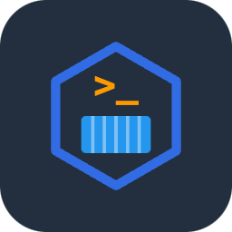

<p align="center">
  
</p>

# aws-kubectl 🛠️

Ubuntu 26.04 image with AWS CLI v2 and kubectl, for CI jobs and in-cluster scripts. Published for `linux/amd64` and `linux/arm64`.

**Image:** [`public.ecr.aws/grasshopper/aws-kubectl`](https://gallery.ecr.aws/grasshopper/aws-kubectl)

[](https://github.com/grasshopper-labs/aws-kubectl-docker/actions/workflows/publish.yml)

```bash
docker pull public.ecr.aws/grasshopper/aws-kubectl:latest
```

## What's in the image

Final stage is `ubuntu:26.04`, digest-pinned in the `Dockerfile`. Dependabot's Docker updates are off, so that digest moves only when a pull request changes it.

| Piece | Source |
| --- | --- |
| AWS CLI v2 (`aws`, `aws_completer`) | Current upstream installer for the target arch, downloaded at build time over TLS. The Dockerfile does not pin or checksum it. Installers exist for `x86_64` and `aarch64` only. |
| kubectl | Build-arg `KUBE_VERSION` (default `latest`). `latest` is the stable release from `https://dl.k8s.io/release/stable.txt`. The binary is checked against the upstream `kubectl.sha256`. The resolved version is written to `/etc/kube-version`. CI passes the stable version it resolved for that run. |
| `jq`, `curl`, `unzip`, `ca-certificates` | `apt-get`, `--no-install-recommends` |
| `envsubst` | package `gettext-base` |

`unzip` stays in the runtime image so pipelines that extract zips keep working. The default user is `app`, UID 10001, GID 0, with `HOME=/home/app`. `CMD` is `bash`. GID 0 is what OpenShift uses when it assigns an arbitrary UID.

CI publishes `linux/amd64` and `linux/arm64`. AWS CLI v2 ships installers for `x86_64` and `aarch64` only, and the Dockerfile rejects any other `TARGETARCH`.

## Tags

[`.github/workflows/publish.yml`](.github/workflows/publish.yml) builds the tag list. [`scripts/push-ecr-public.sh`](scripts/push-ecr-public.sh) applies it. ECR Public will move any tag; the script leaves an existing tag in place when the name is `sha-*`, `kube-*`, or an exact `X.Y.Z` / `vX.Y.Z` (a prerelease suffix such as `-rc.1` included). Rolling tags are pushed first.

`latest` and `edge` are enabled only on the default branch (`flavor: latest=false` plus `enable={{is_default_branch}}`).

| When | Tags | Moved later? |
| --- | --- | --- |
| Push to `main`, the Monday 06:00 UTC rebuild, or a manual dispatch of `main` | `latest`, `edge` | Yes, on the next one of those runs |
| Same branch runs | `sha-<7 hex chars>` | No. Left in place if that tag already exists |
| Push of a `v*.*.*` tag, for example `vX.Y.Z` | `vX.Y.Z` and `X.Y.Z` | No, once present |
| Same tag push | `X.Y` and `X` | Yes, to the newest matching release |
| Same tag push | `kube-<version>` | No. `<version>` is the kubectl release baked into that image (`/etc/kube-version`). Emitted only for tag builds |

A prerelease tag such as `vX.Y.Z-rc.1` still matches `v*.*.*`. metadata-action emits that git tag and the full version (`X.Y.Z-rc.1`), and the push script treats both as immutable. It does not add the rolling `X.Y` and `X` tags for a prerelease.

A digest whose tags are all `sha-<hex>`, and which is older than 90 days, is deleted by [`.github/workflows/ecr-public-tag-cleanup.yml`](.github/workflows/ecr-public-tag-cleanup.yml) (Mondays 07:00 UTC). ECR Public deletes by digest, so a `sha-*` tag that still shares a digest with `latest`, `edge`, or a release tag is kept. Cosign signature tags (`sha256-<digest>.sig`) are not short SHAs.

When the script pushes a digest, it signs that digest once with cosign v2.6.1, keyless, using the GitHub Actions OIDC token for this repository:

```bash
cosign verify public.ecr.aws/grasshopper/aws-kubectl:latest \
  --certificate-identity-regexp "https://github.com/grasshopper-labs/aws-kubectl-docker/.*" \
  --certificate-oidc-issuer "https://token.actions.githubusercontent.com"
```

BuildKit attaches an SPDX SBOM and SLSA provenance (`provenance: mode=max`) to the index that is pushed. The GitHub attestation from `actions/attest-build-provenance` stays in [this repository's attestations](https://github.com/grasshopper-labs/aws-kubectl-docker/attestations). That job has no registry credentials.

Docker Hub tags published as `heyvaldemar/aws-kubectl` were not copied into this registry.

## Usage

```bash
docker run --rm public.ecr.aws/grasshopper/aws-kubectl aws --version
docker run --rm public.ecr.aws/grasshopper/aws-kubectl kubectl version --client
docker run --rm public.ecr.aws/grasshopper/aws-kubectl cat /etc/kube-version
```

Host files under `~/.aws` and `~/.kube` are owned by your user. The image's UID is 10001, so pass your uid and mount them on `/home/app` (`HOME`):

```bash
docker run --rm --user "$(id -u):0" \
  -v "$HOME/.aws:/home/app/.aws" \
  public.ecr.aws/grasshopper/aws-kubectl aws sts get-caller-identity

docker run --rm --user "$(id -u):0" \
  -v "$HOME/.kube:/home/app/.kube" \
  public.ecr.aws/grasshopper/aws-kubectl kubectl get nodes
```

Root, when a workflow needs it: `--user 0:0`.

Since v2.0.0 the default user is UID 10001, GID 0, and the working directory is `/home/app`. The Docker Hub tag `heyvaldemar/aws-kubectl:v1-maintenance` (root, by default) is not in this registry. Its support ended on 2026-07-20; the last rebuild was 2026-04-22.

### Refresh a private ECR pull secret

`aws ecr get-login-password` tokens expire after 12 hours. This CronJob rewrites a `docker-registry` secret every 6 hours. Point `serviceAccountName` at a ServiceAccount that can call `ecr:GetAuthorizationToken` (IRSA or pod identity) and that may create or update the secret. `public.ecr.aws/grasshopper/aws-kubectl` is a public repository, so pulling it needs no secret.

```yaml
apiVersion: batch/v1
kind: CronJob
metadata:
  name: ecr-pull-secret
spec:
  schedule: "0 */6 * * *"
  jobTemplate:
    spec:
      template:
        spec:
          serviceAccountName: ecr-pull-secret
          restartPolicy: OnFailure
          containers:
            - name: refresh
              image: public.ecr.aws/grasshopper/aws-kubectl:latest
              env:
                - name: AWS_REGION
                  value: <region>
                - name: ECR_REGISTRY
                  value: <account-id>.dkr.ecr.<region>.amazonaws.com
                - name: SECRET_NAME
                  value: ecr-pull
              command: ["bash", "-c"]
              args:
                - |
                  set -euo pipefail
                  ns="$(cat /var/run/secrets/kubernetes.io/serviceaccount/namespace)"
                  password="$(aws ecr get-login-password --region "$AWS_REGION")"
                  kubectl create secret docker-registry "$SECRET_NAME" \
                    --namespace "$ns" \
                    --docker-server="$ECR_REGISTRY" \
                    --docker-username=AWS \
                    --docker-password="$password" \
                    --dry-run=client -o yaml \
                    | kubectl apply -f -
```

## CI

[`.github/workflows/publish.yml`](.github/workflows/publish.yml) runs on push to `main`, tags matching `v*.*.*`, pull requests to `main`, Mondays at 06:00 UTC, and `workflow_dispatch`.

GitHub-hosted `ubuntu-latest` runners lint (hadolint, shellcheck, and the script `--self-check`s), build the image and run `scripts/smoke-test.sh` plus `tests/plant-violations.py`, then build one OCI layout for `linux/amd64` and `linux/arm64` (Buildx and QEMU, SBOM, `provenance: mode=max`). Pull requests end after that build. The layout is uploaded only when the event is not a pull request.

**Push to ECR Public** runs only on the self-hosted runner `ecr-public-publisher`. That label is a repo-scoped ARC runner. The pod's IAM role (IRSA or pod identity) is the AWS credential; the workflow stores no AWS keys. GitHub queues the job only when all of these hold:

- `github.repository` is `grasshopper-labs/aws-kubectl-docker`
- the ref is `refs/heads/main` or a `refs/tags/v*` tag
- the event is `push`, `schedule`, or `workflow_dispatch`

The script logs in with `aws ecr-public get-login-password --region us-east-1` (the only region for that API), pushes the layout, checks the digest matches the build, tags the rest, and signs. The repository `public.ecr.aws/grasshopper/aws-kubectl` must already exist.

Trivy then scans the published digest on `ubuntu-latest` and uploads CRITICAL and HIGH fixable findings as SARIF. The image is already in the registry by then.

Sha-tag cleanup uses the same runner and the same repository guard, on `main` only, for `schedule` or `workflow_dispatch`.

## Releasing

1. Push a git tag that matches `v*.*.*` (semantic version, for example `vX.Y.Z`) on `grasshopper-labs/aws-kubectl-docker`. The publish workflow builds the image and pushes the release tags in the table above. `latest` and `edge` stay on whatever `main` last published.
2. Publish a GitHub Release for that tag. [`.github/workflows/release-assets.yml`](.github/workflows/release-assets.yml) attaches three files made on a GitHub-hosted runner, with a short-lived OIDC identity and no stored key:
   - `aws-kubectl-docker-<tag>.tar.gz` — `git archive` of the tag
   - `aws-kubectl-docker-<tag>.tar.gz.sigstore.json` — keyless cosign signature
   - `aws-kubectl-docker-<tag>.intoto.jsonl` — SLSA provenance from `slsa-framework/slsa-github-generator` `@v2.1.0` (pinned by tag because the generator refuses a SHA)

To attach those files to a release that already exists, run **Release Assets** via `workflow_dispatch` and pass the tag.

## Upstream

This tree continues [heyvaldemar/aws-kubectl-docker](https://github.com/heyvaldemar/aws-kubectl-docker) by Vladimir Mikhalev. The image used to be published on Docker Hub as `heyvaldemar/aws-kubectl`. License: MIT (`LICENSE`).
